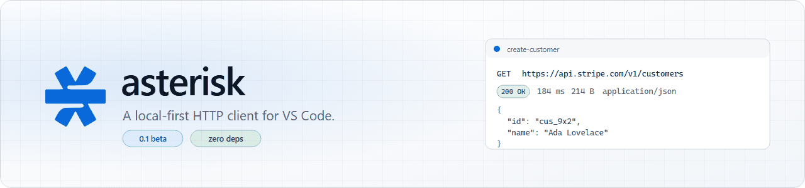

<picture>
	<source media="(prefers-color-scheme: dark)" srcset="docs/banner-dark.png">
	<source media="(prefers-color-scheme: light)" srcset="docs/banner-light.png">
	
</picture>

<p align="center">
	<a href="CHANGELOG.md"></a>
	<a href="test"></a>
	<a href="package.json"></a>
	<a href="LICENSE"></a>
	
</p>

<p align="center"><strong>Postman-style API testing, inside VS Code, with no account, no cloud and no telemetry.</strong><br>Requests, collections, environments and history are plain JSON on disk &mdash; they diff, review and merge like any other file.</p>

---

## Why another HTTP client?

| | asterisk | typical web client |
|---|---|---|
| Your requests | JSON files in `.asterisk/`, committed with your code | A synced account you don't control |
| Network calls | Direct from your machine to your API | Possibly via a vendor's proxy |
| Auth tokens | In memory for the session, never written to disk | Stored in someone's cloud |
| History | Local, secret-redacted, deletable | Synced, searchable by the vendor |
| Runtime footprint | **Zero** runtime dependencies | An Electron app of its own |

## Features

**Requests** — any method, header grid with duplicate-name detection, typed bodies (raw / form-urlencoded / multipart / binary upload), `<input type="file">` picking straight from webview to disk, per-request timeout via `asterisk.timeoutMs`.

**Auth** — Bearer, Basic, API key (header or query), OAuth 2.0 client-credentials and authorization-code with loopback redirect, automatic token refresh, credentials never forwarded across a redirect to another host.

**Environments** — `{{variables}}` resolve in the URL, headers, body and auth; `:path` variables on saved requests; system variables (`{{$uuid}}`, `{{$timestamp}}`, `{{$randomInt}}`); environments and the active one live in `.asterisk/.environments.json`; one dropdown to switch.

**Responses** — pretty-printed JSON with a collapsible tree, headers, find-in-body, copy body, save to file, and timings split into time-to-first-byte and total.

**Scripting** — pre-request and post-response JavaScript in an isolated `vm` realm, with `expect(...)` assertions, `console`, and explicit `setEnv(key, value)`. Test verdicts show up inline in the status strip.

**Collections** — folder tree on disk, drag to move, save from the panel in place, rename/delete, everything git-friendly.

**Runner** — run a folder sequentially against a CSV of rows, see per-iteration pass/fail with the actual row values, optional stop-on-failure.

**Protocols** — WebSocket and Server-Sent Events panes with directional colouring, in-panel connect/cancel/reconnect, and a log that never lies about why it stopped.

**Import / export** — cURL in and out, Postman v2.1, OpenAPI 3, and generated code snippets for cURL / fetch / Python `requests` / Go.

## Install

A released `.vsix`:

```bash
code --install-extension asterisk-0.1.0-beta.1.vsix
```

Or from source:

```bash
git clone https://github.com/nafi/asterisk.git && cd asterisk
bun install
bun run compile
```

Then press <kbd>F5</kbd> in VS Code to launch the Extension Development Host.

## Quick start

1. <kbd>Ctrl</kbd>+<kbd>Alt</kbd>+<kbd>A</kbd> — or the ➕ in the **Asterisk** activity bar — opens the client.
2. Paste a URL, press <kbd>Enter</kbd>. The response lands below.
3. <kbd>Ctrl</kbd>+<kbd>S</kbd> saves the request into a collection; pick a folder, done.
4. Click the collection item later to load it back, `{{vars}}` and all.

### Keyboard

| Key | Action |
|---|---|
| <kbd>Ctrl</kbd>/<kbd>Cmd</kbd>+<kbd>Alt</kbd>+<kbd>A</kbd> | Open the client |
| <kbd>Ctrl</kbd>/<kbd>Cmd</kbd>+<kbd>Enter</kbd> | Send (works from anywhere in the panel; supersedes an in-flight send) |
| <kbd>Enter</kbd> in the URL bar | Send |
| <kbd>Escape</kbd> | Cancel the in-flight request, else close the menu |
| <kbd>Ctrl</kbd>/<kbd>Cmd</kbd>+<kbd>S</kbd> | Save to collection |
| <kbd>←</kbd> <kbd>→</kbd> <kbd>Home</kbd> <kbd>End</kbd> | Move between tabs; on the splitter, resize the request pane |
| <kbd>↑</kbd> <kbd>↓</kbd> | Move through the actions menu |

## How it stores things

```
your-repo/
└── .asterisk/
    ├── .environments.json       # { "active": "staging", "environments": { … } }
    ├── My Collection/           # a collection is just a folder
    │   ├── users/
    │   │   └── list.json        # a request is just a file
    │   └── create-user.json
    └── …
```

A request file is what the panel shows, nothing more:

```json
{
  "method": "POST",
  "url": "{{baseUrl}}/v1/customers",
  "headers": { "Authorization": "Bearer {{token}}" },
  "body": { "type": "raw", "format": "json", "content": "{\"name\": \"Ada\"}" },
  "auth": { "type": "oauth2", "grant": "clientCredentials", "tokenUrl": "…" },
  "preRequest": "setEnv('nonce', String(Date.now()))",
  "test": "expect(response.status).to.equal(200)"
}
```

Because these are ordinary files: review a request in a PR, `git blame` a header, or copy a collection between repos.

### Scripts

Pre-request scripts run before the send and may write environment values; post-response scripts get `response` and can assert:

```js
// test script — `response` is { status, statusText, headers, body, timeMs, size }
expect(response.status).to.equal(200);
expect(response.headers['content-type']).to.match(/application\/json/);
var payload = JSON.parse(response.body);
expect(payload.items).to.have.length(2);
expect(payload.id).to.be.a('string');
```

Assertions read chai-style: `.to.equal`, `.to.eql`, `.to.include`, `.to.match`, `.to.be.a`, `.to.have.length`, `.to.be.above/.below/.least/.most`, `.to.be.true/.false/.null/.undefined`, and `.not` on all of them. Every assertion is recorded, so a failing script reports the first failure *and* how many assertions ran.

Pre-request scripts see `request` and `vars`; scripts cannot reach `process`, `require` or the network. The sandbox is a seatbelt against accidents, not a jail against hostile code, so treat imported collections with the same care as any other code.

## Settings

| Setting | Default | Meaning |
|---|---|---|
| `asterisk.timeoutMs` | `30000` | Request timeout in milliseconds (min 1000). |

## Design notes

- **One send pipeline.** The panel and the runner share `execute()` in `src/runner.ts`; there is exactly one code path that turns a request into bytes on the wire.
- **`--vscode-*` tokens only.** The panel has no hard-coded colours, so light, dark, high-contrast and high-contrast-light all work without a theme of its own.
- **Text is text.** The panel is one HTML file with an inline stylesheet and script: no bundler, no framework, no dependency to audit.
- **The sandbox crosses as JSON.** Helper functions are compiled *inside* the `vm` realm and the payload crosses as a JSON string, so user scripts cannot reach host objects through a constructor chain.
- **Failure tells you what to do.** Every error string in the status strip carries a next step: DNS vs refused vs TLS vs timeout, 401 vs 403 vs 429 vs 5xx.

## Development

Requires [Bun](https://bun.sh) and a POSIX-ish shell.

```bash
bun install
bun run compile          # tsc + copy the webview into out/
bun test                 # 929 unit + DOM tests (bun:test, happy-dom)
bun run lint             # eslint
bun x tsc -p . --noEmit  # type-check
bun run test             # extension-host tests inside a real VS Code
bun x vsce package       # build the .vsix
```

`bun test` runs `pretest`, which fails if `out/webview/main.html` has drifted from `src/webview/main.html` — the panel that ships is the panel that was tested.

Layout: `src/` is the extension host (lazily imported by `extension.ts`), `src/webview/main.html` is the entire UI, `test/` is the unit suite, `src/test/` is the hosted suite, and `FEATURES.md` tracks the milestone-by-milestone state of the build.

## Status

**0.1 beta.** Every advertised feature is implemented and covered by tests; the gaps are deliberate and listed in [FEATURES.md](FEATURES.md) (no multi-root workspaces, sequential runner only, WebSocket without custom headers, no SSE auto-reconnect). Expect rough edges in the UI and the occasional opinionated default. Bug reports with a minimal request file are very welcome.

## License

[MIT](LICENSE) © nafi
